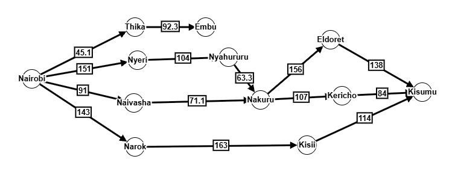
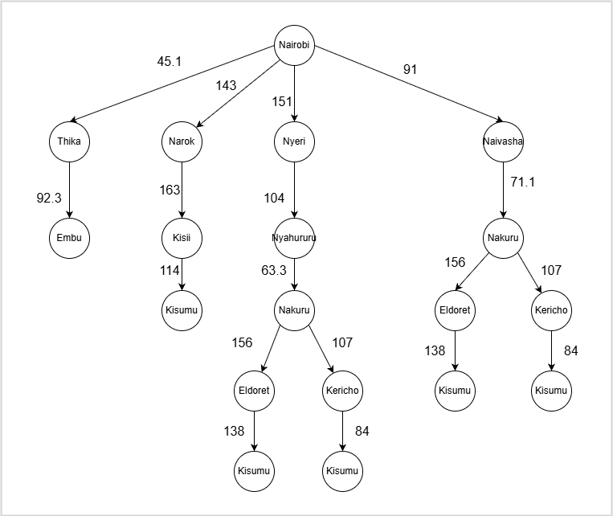
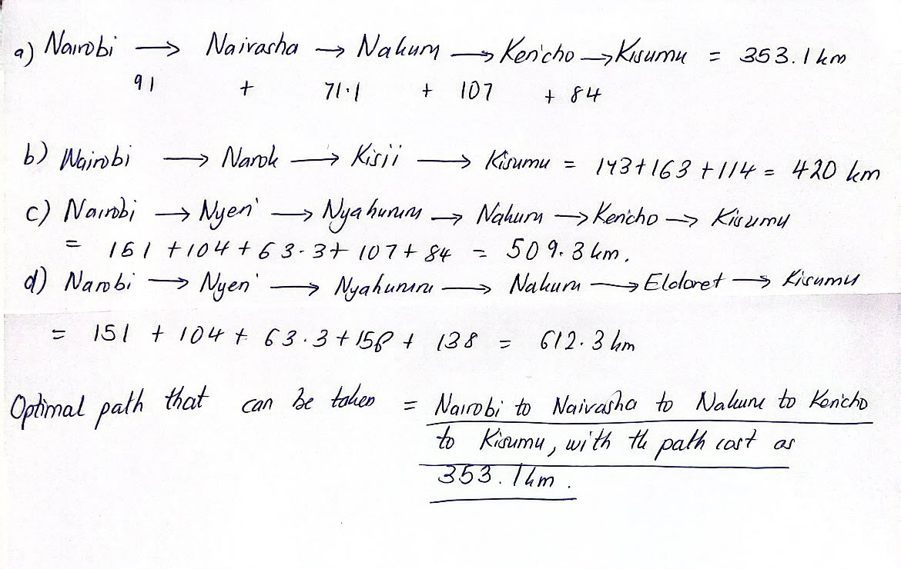

# ICS 3202: Artificial Intelligence

## Practical Exercise 3: Designing a Searching Agent

## Group Members:

- 191630 Munene Michelle Gakenyi

- 177480 Miheso Aoi Mmitsi

- 190431 Ochieng Wendy Wendo

---

***Based on the class discussion on the self-driving trailer agent:***

1. **Design the agent using the PEAS framework and further define its environment using the 5 definitions of agent environments.**

    ***a. Using PEAS framework.***
        
    - **P – Performance measure**: safety of trailer and its contents upon arrival, compliance with traffic regulations, total time taken to reach the destination, fuel consumption efficiency.
    
    - **E – Environment**: highways and roads in Kenya, pedestrians, other vehicles, traffic, traffic lights, road signs, the destination and weather conditions
    
    - **A – Actuators**: steering wheel, brakes, accelerator, gears, horns.
    
    - **S – Sensors**: cameras, GPS, speedometer, LiDAR (Light Detection and Ranging), proximity sensors and sensors detecting road signs and traffic lights.

    ***b. Self-driving trailer agent environments.***

    - It is a **partially observable agent** – Information about the environment is not fully available to the trailer as there are factors such as weather conditions that change from time to time. The sensors may also not be able to detect certain obstacles or hazards, especially if hidden or obstructed from view.
    
    - It is a **stochastic agent** – other agents such as other drivers, pedestrians, weather conditions may act unpredictably.
    
    - It is a **sequential agent** – each driving action affects future situations for example changing lanes affects the trailer’s position and following decisions.
    
    - It is a **dynamic agent** – environment is changing as the trailer is selecting an option since other cars and pedestrians are constantly moving.
    
    - It is a **multi-agent** – the trailer is operating with other agents in the environment that is other drivers, pedestrians, cyclists and emergency vehicles.

--- 

2. **Develop a suitable directed graph and search tree based on the map presented in class of Kenya’s Highway Network featuring cities and towns in the Nairobi, Central Highlands, Rift Valley and Lake Victoria Basin regions. For reference, you can use this Google Maps view to generate the graph and tree. The tree should apply the concept of abstraction as discussed in class.**

    

    

---

3. **Using distance between towns as the path cost function, determine the optimal path the trailer can take from Nairobi to Kisumu. Calculate the distance between towns using this Google Maps search feature.**

    Using the distance between towns as the path cost function g(n), we traced every path from Nairobi to Kisumu in the search tree from the directed graph in question two above, and added the distances along the route. The calculations are as shown below.

    

    The Nairobi to Thika to Embu route does not reach Kisumu, hence the route is not considered as a candidate.

    The optimal path is Nairobi to Naivasha to Nakuru to Kericho to Kisumu, with a path cost of **353.1 km**. It has the **lowest total path cost** of all the paths that reach Kisumu.
